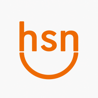

# Financeiro HSN — novo visual por tópicos

Atualização de apresentação sobre a Fase 6 Push já instalada. Nenhum SQL necessário.
Não substitui os arquivos financeiros, credenciais, permissões ou dados existentes.

## Organização

- Dia a dia: contas, calendário, recorrentes, alertas de contas e DDA.
- Comissões: lançamentos e alertas próprios.
- Análises: previsão de caixa, relatórios, importação e reajustes.
- Cadastros: fornecedores, tipos, feriados e mensagens.
- Sistema: notificações, configurações, histórico e backups.

No computador, clique em um tópico para expandir as opções. No celular, toque em Explorar módulos e depois no tópico desejado. Ao escolher uma opção, o menu se recolhe. Os temas claro, escuro e sistema continuam disponíveis.

## Instalação no GitHub

1. Extraia este ZIP.
2. Abra seu repositório Financeiro---HSN.
3. Add file → Upload files.
4. Arraste index.html, service-worker.js e as pastas css e js DESTE pacote diretamente na área de envio. Não arraste a pasta externa.
5. Confira os caminhos: index.html, service-worker.js, css/layout.css, js/layout.js.
6. Commit changes. Não apague nenhuma pasta ou arquivo anterior. O css/style.css e todos os scripts atuais continuam necessários.
7. Não envie este guia.
8. Aguarde o GitHub Pages concluir a publicação (aba Actions).
9. Feche todas as abas e janelas do app no computador e celular e abra novamente. Pode ser necessário repetir para ativar o novo service worker.

## SPCK (se continuar editando por ele)

- Substitua o conteúdo completo de index.html pelo arquivo deste pacote.
- Substitua o conteúdo completo de service-worker.js pelo arquivo deste pacote.
- Dentro de css, crie layout.css e copie TODO o arquivo correspondente.
- Dentro de js, crie layout.js e copie TODO o arquivo correspondente.
- Não substitua as pastas inteiras nem apague os arquivos existentes.

## Como testar

1. Abra os cinco tópicos e confira os 19 módulos.
2. No celular, abra Explorar módulos, escolha Calendário e confira o recolhimento do menu.
3. Alterne entre claro e escuro e confira tabelas, cartões e um formulário.
4. Confira uma conta, seus documentos e o botão Tirar foto sem precisar salvar alterações.
5. Confira relatórios, comissões e DDA nos respectivos tópicos.
6. Em Sistema → Notificações no telefone, envie um teste ao Android já cadastrado. Não precisa gerar chaves ou recadastrar o aparelho.

## Se algo não aparecer

- Visual antigo: aguarde a publicação e feche TODAS as abas/janelas antes de reabrir.
- Página sem estilo: confira se css/style.css foi mantido e css/layout.css existe no caminho correto.
- Menu do celular não abre: confira js/layout.js e a publicação do index.html novo.
- Para voltar ao visual anterior: restaure index.html e service-worker.js da versão anterior pelo histórico do GitHub; os dois novos arquivos podem permanecer sem uso.

Validação feita: sintaxe JavaScript, preservação de todos os IDs existentes e dos 19 módulos, scripts anteriores, abertura dos tópicos, seleção ativa, recolhimento móvel, tecla Escape e preservação integral dos handlers de push. A conferência visual final deve ser feita no seu celular e computador após publicar.

## Código completo — index.html

```html
<!doctype html>
<html lang="pt-BR"><head><meta charset="utf-8"><meta name="viewport" content="width=device-width, initial-scale=1"><meta name="theme-color" content="#f5f6f8"><meta name="apple-mobile-web-app-capable" content="yes"><link rel="manifest" href="manifest.json"><link rel="apple-touch-icon" href="icons/icon-192.png"><link rel="icon" href="icons/icon-192.png"><script src="js/theme.js"></script><link rel="stylesheet" href="css/style.css"><link rel="stylesheet" href="css/layout.css"><title>Financeiro HSN</title></head>
<body>
<header class="app-header">
 <div class="brand"><div><strong>Financeiro <span>HSN</span></strong><small>Hotel Serra Negra</small></div></div>
 <div class="header-actions"><button id="theme-toggle" type="button" class="secondary" aria-label="Alternar tema">Modo escuro</button><label class="theme-choice"><span>Tema</span><select id="theme-select" aria-label="Escolher tema"><option value="system">Sistema</option><option value="light">Claro</option><option value="dark">Escuro</option></select></label><button id="logout" class="secondary" hidden>Sair</button></div>
</header>
<p id="notice" role="status" aria-live="polite"></p>
<main class="workspace"><section id="login" class="card"><div class="login-symbol"></div><small class="eyebrow">BEM-VINDO AO FINANCEIRO HSN</small><h1>Suas contas,<br>em um só lugar.</h1><p>Entre com sua senha. Sua sessão permanece neste aparelho até você sair.</p><form id="login-form"><label>Senha<input id="password" type="password" autocomplete="current-password" required minlength="6"></label><button type="submit">Entrar</button></form></section>
<section id="app" hidden><aside class="sidebar"><button type="button" id="navigation-toggle" class="navigation-toggle secondary" aria-expanded="false" aria-controls="topic-navigation"><span>☰ &nbsp; Explorar módulos</span><span id="navigation-current">Contas a pagar</span></button><div class="sidebar-heading">SEU FINANCEIRO</div><nav id="topic-navigation" aria-label="Módulos por tópico"><details class="nav-topic" data-topic="01" open><summary><span class="topic-number">01</span><span class="topic-copy"><strong>Dia a dia</strong><small>Contas, vencimentos e cobranças</small></span><span class="topic-chevron" aria-hidden="true">⌄</span></summary><div class="topic-links"><button data-view="payables"><span class="nav-icon"><svg viewBox="0 0 24 24" fill="none" stroke="currentColor" stroke-width="1.6" stroke-linecap="round" stroke-linejoin="round" aria-hidden="true"><path d="M5 3h14v18H5z M8 7h8 M8 11h8 M8 15h5"/></svg></span><span>Contas a pagar</span></button><button data-view="calendar"><span class="nav-icon"><svg viewBox="0 0 24 24" fill="none" stroke="currentColor" stroke-width="1.6" stroke-linecap="round" stroke-linejoin="round" aria-hidden="true"><path d="M4 5h16v15H4z M8 3v4 M16 3v4 M4 10h16"/></svg></span><span>Calendário</span></button><button data-view="recurring_models"><span class="nav-icon"><svg viewBox="0 0 24 24" fill="none" stroke="currentColor" stroke-width="1.6" stroke-linecap="round" stroke-linejoin="round" aria-hidden="true"><path d="M20 7a8 8 0 0 0-14-2L3 8 M3 3v5h5 M4 17a8 8 0 0 0 14 2l3-3 M21 21v-5h-5"/></svg></span><span>Recorrentes</span></button><button data-view="alerts"><span class="nav-icon"><svg viewBox="0 0 24 24" fill="none" stroke="currentColor" stroke-width="1.6" stroke-linecap="round" stroke-linejoin="round" aria-hidden="true"><path d="M12 3a6 6 0 0 0-6 6v5l-2 3h16l-2-3V9a6 6 0 0 0-6-6z M10 21h4"/></svg></span><span>Alertas de contas</span><span id="payable-alert-count" class="nav-count">0</span></button><button data-view="dda"><span class="nav-icon">◆</span><span>DDA</span></button></div></details><details class="nav-topic" data-topic="02"><summary><span class="topic-number">02</span><span class="topic-copy"><strong>Comissões</strong><small>Conferência e alertas separados</small></span><span class="topic-chevron" aria-hidden="true">⌄</span></summary><div class="topic-links"><button data-view="commissions" class="commission-nav"><span class="nav-icon"><svg viewBox="0 0 24 24" fill="none" stroke="currentColor" stroke-width="1.6" stroke-linecap="round" stroke-linejoin="round" aria-hidden="true"><path d="M12 3l3 6 6 3-6 3-3 6-3-6-6-3 6-3z"/></svg></span><span>Comissões</span></button><button data-view="commission_alerts" class="commission-nav"><span class="nav-icon"><svg viewBox="0 0 24 24" fill="none" stroke="currentColor" stroke-width="1.6" stroke-linecap="round" stroke-linejoin="round" aria-hidden="true"><path d="M12 3a6 6 0 0 0-6 6v5l-2 3h16l-2-3V9a6 6 0 0 0-6-6z M10 21h4"/></svg></span><span>Alertas de comissões</span><span id="commission-alert-count" class="nav-count commission-pill">0</span></button></div></details><details class="nav-topic" data-topic="03"><summary><span class="topic-number">03</span><span class="topic-copy"><strong>Análises</strong><small>Relatórios e planejamento</small></span><span class="topic-chevron" aria-hidden="true">⌄</span></summary><div class="topic-links"><button data-view="cash_forecast"><span class="nav-icon">▥</span><span>Previsão de caixa</span></button><button data-view="reports"><span class="nav-icon">▤</span><span>Relatórios</span></button><button data-view="imports"><span class="nav-icon">⇄</span><span>Importar Excel / CSV</span></button><button data-view="adjustments"><span class="nav-icon">◷</span><span>Reajustes</span></button></div></details><details class="nav-topic" data-topic="04"><summary><span class="topic-number">04</span><span class="topic-copy"><strong>Cadastros</strong><small>Sua base de informações</small></span><span class="topic-chevron" aria-hidden="true">⌄</span></summary><div class="topic-links"><button data-view="suppliers"><span class="nav-icon"><svg viewBox="0 0 24 24" fill="none" stroke="currentColor" stroke-width="1.6" stroke-linecap="round" stroke-linejoin="round" aria-hidden="true"><path d="M8 11a4 4 0 1 0 0-8 4 4 0 0 0 0 8z M2 21v-3a6 6 0 0 1 12 0v3 M17 4a4 4 0 0 1 0 8 M18 15a5 5 0 0 1 4 5"/></svg></span><span>Fornecedores</span></button><button data-view="account_types"><span class="nav-icon"><svg viewBox="0 0 24 24" fill="none" stroke="currentColor" stroke-width="1.6" stroke-linecap="round" stroke-linejoin="round" aria-hidden="true"><path d="M3 4h8l10 10-7 7L3 10z M7 8h.01"/></svg></span><span>Tipos de conta</span></button><button data-view="local_holidays"><span class="nav-icon"><svg viewBox="0 0 24 24" fill="none" stroke="currentColor" stroke-width="1.6" stroke-linecap="round" stroke-linejoin="round" aria-hidden="true"><path d="M4 5h16v15H4z M8 3v4 M16 3v4 M4 10h16 M9 15l2 2 4-4"/></svg></span><span>Feriados</span></button><button data-view="message_templates"><span class="nav-icon"><svg viewBox="0 0 24 24" fill="none" stroke="currentColor" stroke-width="1.6" stroke-linecap="round" stroke-linejoin="round" aria-hidden="true"><path d="M4 4h16v12H9l-5 4z M8 8h8 M8 12h5"/></svg></span><span>Mensagens</span></button></div></details><details class="nav-topic" data-topic="05"><summary><span class="topic-number">05</span><span class="topic-copy"><strong>Sistema</strong><small>Preferências e segurança</small></span><span class="topic-chevron" aria-hidden="true">⌄</span></summary><div class="topic-links"><button data-view="push"><span class="nav-icon">♧</span><span>Notificações no telefone</span></button><button data-view="alert_settings"><span class="nav-icon"><svg viewBox="0 0 24 24" fill="none" stroke="currentColor" stroke-width="1.6" stroke-linecap="round" stroke-linejoin="round" aria-hidden="true"><path d="M4 6h16 M4 12h16 M4 18h16 M8 4v4 M16 10v4 M10 16v4"/></svg></span><span>Configurações</span></button><button data-view="audit"><span class="nav-icon">≡</span><span>Histórico</span></button><button data-view="backups"><span class="nav-icon">⇩</span><span>Backups</span></button></div></details></nav><div class="sidebar-foot"><span class="status-dot"></span>Dados centralizados<div>Hotel Serra Negra · uso pessoal</div></div></aside><div class="content"><div class="workspace-tools"><p id="connection"></p><div><button id="refresh" class="secondary">Atualizar</button><button id="daily-summary-open" class="secondary">Resumo diário</button><button id="install" class="secondary" hidden>Instalar app</button></div></div><div class="page-heading"><div><small class="eyebrow">PAINEL FINANCEIRO</small><h1 id="view-title">Contas a pagar</h1><p id="view-description" class="muted">Organize vencimentos, documentos e pagamentos.</p></div><button id="new">Novo cadastro</button></div><div class="search-wrap"><label>Buscar<input id="search" type="search" placeholder="Pesquisar por descrição, fornecedor ou referência"></label></div><div id="summary" class="summary"></div><div id="finance-controls" class="finance-controls"></div><div id="calendar-board"></div><div id="commission-calendar-summary"></div><div id="records" class="records"></div><footer class="content-footer"><span>Financeiro HSN</span><span>Contas e comissões em módulos separados</span></footer></div></section></main>
<dialog id="editor"><form id="edit-form"><div class="topline"><h2 id="edit-title"></h2><button type="button" id="close-editor">Fechar</button></div><div id="fields"></div><div class="actions"><button type="submit">Salvar no Supabase</button></div></form></dialog>
<dialog id="whatsapp"><form method="dialog"><div class="topline"><h2>Enviar pelo WhatsApp</h2><button>Fechar</button></div></form><label>Contato<select id="wa-contact"></select></label><label>Modelo<select id="wa-template"></select></label><div class="grid"><label>Competência<input id="wa-month" type="month"></label><label>Valor (R$)<input id="wa-value" type="number" min="0" step="0.01"></label></div><button id="wa-fill">Preencher mensagem</button><label>Mensagem editável<textarea id="wa-text" rows="6" maxlength="2000"></textarea></label><p id="wa-warning"></p><button id="wa-open">Abrir WhatsApp</button></dialog>
<dialog id="finance-dialog"><form id="finance-form"><div class="topline"><div><small class="eyebrow">FINANCEIRO HSN</small><h2 id="finance-title"></h2></div><button type="button" id="finance-close" class="secondary">Fechar</button></div><div id="finance-fields"></div><div class="actions"><button type="submit">Salvar no Supabase</button></div></form></dialog><dialog id="documents-dialog"><div class="topline"><h2 id="documents-title">Documentos</h2><button id="documents-close" class="secondary">Fechar</button></div><p id="documents-info"></p><form id="document-upload"><div class="grid"><label>Tipo<select id="document-kind"><option value="boleto">Boleto</option><option value="nota_fiscal">Nota fiscal</option><option value="comprovante">Comprovante</option><option value="outros">Outros</option></select></label><div class="attachment-picker"><span class="field-caption">Arquivo · PDF, JPG ou PNG, até 20 MB</span><div class="attachment-buttons"><button type="button" id="document-browse" class="secondary">Selecionar arquivo</button><button type="button" id="document-take-photo" class="secondary">Tirar foto</button></div><input id="document-file" type="file" accept="application/pdf,image/jpeg,image/png" hidden><input id="document-camera" type="file" accept="image/jpeg,image/png" capture="environment" hidden><p id="document-selected" class="muted" aria-live="polite">Nenhum arquivo selecionado.</p><button id="document-clear" type="button" class="secondary" hidden>Remover seleção</button></div></div><div class="reading-tools"><div class="topline"><button type="button" id="reading-start" class="secondary">Ler boleto / nota fiscal</button><button type="button" id="reading-cancel" class="secondary" hidden>Cancelar leitura</button></div><div class="grid"><label>Orientação da foto<select id="reading-rotation"><option value="0">Como está</option><option value="90">Girar 90°</option><option value="180">Girar 180°</option><option value="270">Girar 270°</option></select></label><label class="read-note-choice"><input id="reading-force" type="checkbox">PDF: tentar OCR mesmo se houver texto</label></div><p id="reading-progress" class="muted" role="status" aria-live="polite"></p><p class="muted">Leitura gratuita no aparelho. Confira antes de aplicar; selecionar ou ler não envia o arquivo.</p></div><button id="document-upload-submit" type="submit">Adicionar ao histórico</button></form><div id="document-list"></div></dialog><dialog id="preview-dialog"><div class="topline"><h2>Conferir lançamentos do mês</h2><button id="preview-close" class="secondary">Fechar</button></div><p id="preview-info"></p><div id="preview-list"></div><button id="preview-confirm">Confirmar geração</button></dialog><dialog id="phase3-dialog"><form id="phase3-form"><div class="topline"><h2 id="phase3-title"></h2><button type="button" id="phase3-close" class="secondary">Fechar</button></div><div id="phase3-fields"></div><button id="phase3-submit" type="submit">Salvar no Supabase</button></form></dialog><dialog id="daily-summary-dialog"><div class="topline"><h2>Resumo diário · Financeiro HSN</h2><button id="daily-summary-close" class="secondary">Fechar</button></div><p>Contas e comissões em painéis separados. Próximos 7 dias a partir de hoje.</p><div id="daily-summary-content"></div></dialog><dialog id="reading-dialog"><form id="reading-form"><div class="topline"><h2>Conferir leitura do documento</h2><button id="reading-close" type="button" class="secondary">Fechar sem aplicar</button></div><p id="reading-description" class="muted"></p><div id="reading-fields"></div><button type="submit">Aplicar campos conferidos ao formulário</button></form></dialog><dialog id="phase4-dialog"><form id="phase4-form"><div class="topline"><h2 id="phase4-title"></h2><button type="button" id="phase4-close" class="secondary">Fechar</button></div><div id="phase4-fields"></div><button type="submit" id="phase4-submit">Salvar</button></form></dialog><dialog id="import-dialog"><div class="topline"><h2>Conferir importação</h2><button id="import-close" class="secondary">Fechar sem importar</button></div><p id="import-info" class="hint"></p><div id="import-review"></div><button id="import-confirm">Confirmar linhas selecionadas</button></dialog><script src="https://cdn.jsdelivr.net/npm/@supabase/supabase-js@2.102.0/dist/umd/supabase.js"></script><script src="js/config.js"></script><script src="js/utils.js"></script><script src="js/dates.js"></script><script src="js/boletos.js"></script><script src="js/alerts-engine.js"></script><script src="js/phase3.js"></script><script src="js/attachments.js"></script><script src="js/document-parser.js"></script><script src="js/ocr-reader.js"></script><script src="js/document-reading.js"></script><script src="js/import-rules.js"></script><script src="js/phase4.js"></script><script src="js/planning-engine.js"></script><script src="js/phase5.js"></script><script src="js/push-engine.js"></script><script src="js/push.js"></script><script src="js/finance.js"></script><script src="js/app.js"></script><script src="js/layout.js"></script></body></html>

```

## Código completo — css/layout.css

```css
/* Financeiro HSN · edição visual. Estilo base e regras financeiras preservados. */
:root{--bg:#f3f5f8;--surface:#ffffff;--surface2:#f7f8fb;--surface3:#edf1f6;--ink:#18283e;--muted:#61718a;--line:#e1e7ef;--accent:#dd691b;--accent-soft:#fff0e5;--accent-ink:#a7470d;--sidebar:276px;--header:76px;--shadow:0 4px 24px #1d35570a}
:root[data-theme=dark]{--bg:#0d1420;--surface:#141f2e;--surface2:#192638;--surface3:#223148;--ink:#ebf1fa;--muted:#acbcd1;--line:#2a3a50;--accent:#f6a15e;--accent-soft:#382a22;--accent-ink:#ffc28f;--shadow:0 6px 24px #0000001a}
body{background:var(--bg);font-size:16px;line-height:1.6;-webkit-font-smoothing:antialiased}
.app-header{height:var(--header);padding:12px 28px;background:var(--surface);box-shadow:0 2px 14px #162e4905}
.brand-logo{width:44px;height:44px;border:1px solid var(--line);border-radius:14px}.brand strong{font-size:21px;letter-spacing:-.8px}.brand small{font-size:12px;letter-spacing:.25px}
.header-actions{gap:8px}.header-actions button,.theme-choice select{border-radius:10px;min-height:40px}.theme-choice>span{display:none}
.sidebar{padding:24px 14px;background:var(--surface);scrollbar-width:thin;scrollbar-color:var(--line) transparent}.sidebar-heading{padding:0 12px;margin-bottom:18px;font-size:10px;letter-spacing:2px}
.sidebar nav{display:flex;flex-direction:column;gap:9px;overflow:visible;padding:0}.nav-topic{border:1px solid transparent;border-radius:14px;overflow:hidden;flex-shrink:0}.nav-topic[open]{border-color:var(--line);background:var(--surface2)}
.nav-topic>summary{list-style:none;display:flex;align-items:center;gap:11px;padding:13px 10px;cursor:pointer;min-height:67px;user-select:none}.nav-topic>summary::-webkit-details-marker{display:none}.nav-topic>summary:hover{background:var(--surface2)}.topic-number{font-size:11px;font-weight:750;display:grid;place-items:center;width:30px;height:34px;border:1px solid var(--line);border-radius:10px;color:var(--muted);background:var(--surface);flex-shrink:0}.topic-copy{flex:1;min-width:0}.topic-copy strong{display:block;font-size:14px;font-weight:700;line-height:1.5}.topic-copy small{font-size:10px;display:block;white-space:normal;color:var(--muted);line-height:1.5}.topic-chevron{font-size:19px;color:var(--muted);transition:transform .18s}.nav-topic[open] .topic-chevron{transform:rotate(180deg)}.has-current .topic-number{background:var(--accent-soft);border-color:transparent;color:var(--accent-ink)}
.topic-links{padding:0 7px 8px;display:flex;flex-direction:column;gap:3px}.sidebar nav .topic-links button{min-height:43px;padding:10px 11px;font-size:13px;border-radius:9px;color:var(--muted);white-space:normal;line-height:1.45}.topic-links button>span:nth-child(2){flex:1}.sidebar nav .topic-links button.active{background:var(--accent-soft);color:var(--accent-ink);box-shadow:inset 3px 0 var(--accent)}.sidebar nav .topic-links button.commission-nav.active{background:var(--purple-soft);color:var(--purple);box-shadow:inset 3px 0 var(--purple)}.nav-count{font-size:11px;border-radius:20px;padding:2px 7px}.sidebar-foot{margin:24px 12px 0;padding-top:18px;font-size:11px}.sidebar-foot div{font-size:10px}.navigation-toggle{display:none}
.content{padding:24px clamp(20px,3vw,46px) 32px;max-width:1800px}.workspace-tools{margin-bottom:24px;padding-bottom:18px;border-bottom:1px solid var(--line)}.workspace-tools>div{flex-wrap:wrap}.workspace-tools p{font-size:12px}.workspace-tools button{font-size:12px;border-radius:9px;min-height:38px}.page-heading{margin:0 0 22px;gap:18px}.page-heading h1{font-size:clamp(27px,2.5vw,35px);letter-spacing:-1.2px;font-weight:750;scroll-margin-top:100px}.page-heading .eyebrow{font-size:10px;letter-spacing:2px}.page-heading .muted{font-size:14px}.page-heading>button{border-radius:11px;padding:11px 19px;box-shadow:0 4px 12px #d96b1920}
button{border-radius:10px}button.secondary:hover{background:var(--surface2);border-color:var(--muted)}input,select,textarea{border-radius:10px;background:var(--surface);transition:border-color .15s}label{color:var(--muted)}.search-wrap{max-width:560px;margin-bottom:18px}.search-wrap label{font-size:11px;letter-spacing:1.3px}.search-wrap input{background:var(--surface);border-radius:12px;padding:13px 16px;min-height:48px;box-shadow:none}
.summary{gap:14px;margin:20px 0}.stat{padding:20px 22px;border-radius:16px;border-color:var(--line);box-shadow:var(--shadow)}.stat:before{position:absolute;left:0;top:22px;width:3px;height:30px;border-radius:0 4px 4px 0;margin:0}.stat small{font-size:13px}.stat strong{font-size:29px;letter-spacing:-1px;margin:8px 0 3px;font-variant-numeric:tabular-nums}.stat .muted{font-size:12px}.finance-controls{padding:16px;border-radius:14px;gap:12px;box-shadow:var(--shadow)}.finance-controls input,.finance-controls select{background:var(--surface2);border-radius:9px}.finance-controls label{font-size:12px}
.card,.record{border-radius:16px;padding:22px;box-shadow:var(--shadow)}.record h2{font-size:18px}.record p{font-size:14px}.records{gap:16px}.record-accent{height:3px}.pill{border-radius:7px;font-size:11px;letter-spacing:.1px;padding:5px 9px}.actions{gap:8px}.actions button{font-size:13px;border-radius:9px;min-height:42px}.account-table-wrap{border-radius:15px;box-shadow:var(--shadow)}.account-table thead{background:var(--surface2)}.account-table th{padding:16px;font-size:11px;letter-spacing:.7px}.account-table td{padding:17px 16px;font-size:14px}.account-table tbody tr:hover{background:var(--surface2)}.account-table td:first-child strong{font-size:14px}.account-table .table-money{font-size:16px;font-variant-numeric:tabular-nums}.table-actions summary{border-radius:8px;background:var(--surface);font-size:13px;padding:8px 12px}.hint{border-radius:12px;font-size:13px;padding:15px 17px}.calendar-wrap{border-radius:16px;box-shadow:var(--shadow)}.weekday{font-size:12px}.day{padding:12px}.today-strip{border-radius:14px}.content-footer{font-size:11px;margin-top:32px;color:var(--muted)}
dialog{border-radius:20px;padding:26px;box-shadow:0 24px 100px #00000050}dialog::backdrop{background:#07142699;backdrop-filter:blur(6px)}dialog h2{font-size:22px}.contact,.reading-tools,.read-field{border-radius:12px}#login{margin:60px auto;max-width:460px;padding:40px;border-radius:24px;box-shadow:0 20px 70px #1b345414}#login h1{font-size:36px;letter-spacing:-1.5px}#login button{min-height:48px;border-radius:12px}.login-symbol img{border:1px solid var(--line);box-shadow:var(--shadow)}
@media(min-width:1650px){.content{padding:30px 48px}.records{grid-template-columns:repeat(4,minmax(0,1fr))}}
@media(max-width:1100px) and (min-width:851px){:root{--sidebar:250px}.content{padding:22px}.topic-copy small{font-size:9px}}
@media(max-width:850px){:root{--header:68px}.app-header{padding:10px 14px;gap:10px}.brand-logo{width:38px;height:38px}.brand strong{font-size:18px}.brand small{font-size:10px}.header-actions button{font-size:12px;padding:8px 10px}.sidebar{position:relative;top:auto;bottom:auto;width:100%;padding:12px 14px;background:var(--surface);border-bottom:1px solid var(--line);z-index:10}.sidebar-heading,.sidebar-foot{display:none}.navigation-toggle{display:flex;width:100%;align-items:center;justify-content:space-between;gap:12px;text-align:left;background:var(--surface2)!important;font-size:14px;min-height:46px}.navigation-toggle>span:last-child{font-size:11px;color:var(--muted);max-width:45%;overflow:hidden;text-overflow:ellipsis;white-space:nowrap}.sidebar nav{display:none;max-height:65dvh;overflow-y:auto;margin-top:12px}.sidebar.menu-open nav{display:flex}.nav-topic>summary{min-height:62px;padding:10px}.topic-copy strong{font-size:15px}.topic-copy small{font-size:11px}.sidebar nav .topic-links button{font-size:14px;min-height:46px}.content{margin-left:0;padding:20px 16px}.workspace-tools{gap:10px;margin-bottom:22px;padding-bottom:15px}.workspace-tools p{font-size:12px}.workspace-tools button{font-size:12px;min-height:38px}.page-heading h1{font-size:28px}.page-heading .muted{font-size:13px}.page-heading>button{font-size:13px;padding:10px 14px}.summary{gap:10px}.stat{padding:17px}.stat strong{font-size:25px}.theme-choice{display:none}.records{grid-template-columns:repeat(2,minmax(0,1fr))}}
@media(max-width:600px){.app-header{gap:6px}.brand{gap:8px}.brand strong{font-size:16px}.brand-logo{width:34px;height:36px}.header-actions{gap:5px}.header-actions button{font-size:11px;padding:7px 9px;min-height:36px}.content{padding:20px 13px}.workspace-tools{align-items:flex-start;flex-direction:column}.workspace-tools>div{gap:6px}.page-heading{gap:10px}.page-heading h1{font-size:27px}.page-heading .eyebrow{font-size:9px}.page-heading .muted{font-size:13px}.page-heading>button{padding:10px;font-size:12px}.search-wrap{max-width:none}.search-wrap input{font-size:16px}.summary{grid-template-columns:1fr 1fr}.stat{padding:15px;border-radius:13px}.stat small{font-size:12px}.stat strong{font-size:23px;overflow-wrap:anywhere}.stat .muted{font-size:11px}.records{grid-template-columns:1fr}.card,.record{padding:18px;border-radius:14px}.finance-controls{padding:13px}.finance-controls input,.finance-controls select{font-size:16px}.account-table-wrap{background:transparent;box-shadow:none;border:0;overflow:visible}.account-table tr{border-radius:14px;padding:16px;box-shadow:var(--shadow);margin-bottom:12px}.account-table td{padding:10px 0;font-size:14px}.account-table td:first-child strong{font-size:16px}.account-table th{padding:0}.account-table tbody tr:hover{background:var(--surface)}.content-footer{font-size:11px;gap:4px}dialog{padding:20px;width:calc(100% - 20px);border-radius:18px}#login{margin:32px 14px;padding:28px}#login h1{font-size:32px}.grid{grid-template-columns:1fr}}
@media(prefers-reduced-motion:reduce){*{scroll-behavior:auto!important;transition:none!important}}

```

## Código completo — js/layout.js

```javascript
/* Somente navegação e apresentação. Não acessa dados, Auth ou permissões. */
(() => {
 'use strict';
 const sidebar=document.querySelector('.sidebar');
 const toggle=document.getElementById('navigation-toggle');
 const nav=document.getElementById('topic-navigation');
 if(!sidebar||!toggle||!nav)return;
 const groups=[...nav.querySelectorAll('.nav-topic')];
 const mobile=()=>window.matchMedia('(max-width: 850px)').matches;
 function closeMenu(){sidebar.classList.remove('menu-open');toggle.setAttribute('aria-expanded','false');}
 toggle.addEventListener('click',()=>{const open=sidebar.classList.toggle('menu-open');toggle.setAttribute('aria-expanded',String(open));});
 groups.forEach(group=>group.querySelector('summary').addEventListener('click',()=>{
  if(!group.open)groups.forEach(other=>{if(other!==group)other.open=false;});
 }));
 let lastActive=null;
 function sync(){
  const active=nav.querySelector('[data-view].active');
  nav.querySelectorAll('[data-view]').forEach(b=>{if(b===active)b.setAttribute('aria-current','page');else b.removeAttribute('aria-current');});
  groups.forEach(g=>{const selected=!!active&&g.contains(active);if(g.classList.contains('has-current')!==selected)g.classList.toggle('has-current',selected);});
  if(active&&active!==lastActive){const group=active.closest('.nav-topic');groups.forEach(other=>{other.open=other===group;});lastActive=active;}
  const title=document.getElementById('view-title')?.textContent;
  if(title)document.getElementById('navigation-current').textContent=title;
 }
 nav.addEventListener('click',event=>{if(event.target.closest('[data-view]')&&mobile()){closeMenu();document.getElementById('view-title')?.scrollIntoView?.({block:'start',behavior:'auto'});}});
 document.addEventListener('keydown',event=>{if(event.key==='Escape'&&sidebar.classList.contains('menu-open')){closeMenu();toggle.focus();}});
 const observer=new MutationObserver(sync);
 observer.observe(nav,{attributes:true,subtree:true,attributeFilter:['class']});
 const title=document.getElementById('view-title');
 if(title)new MutationObserver(sync).observe(title,{childList:true,characterData:true,subtree:true});
 // Evita ciclos de observação ao aplicar os mesmos atributos/classes.
 sync();
})();

```

## Código completo — service-worker.js

```javascript
// Somente arquivos estáticos. Nunca cachear Auth, API, documentos ou CDN.
const CACHE='hsn-shell-v6-layout-1';
const SHELL=['./','./index.html','./css/style.css','./css/layout.css','./js/layout.js','./js/config.js','./js/theme.js','./js/utils.js','./js/app.js','./js/finance.js','./js/import-rules.js','./js/phase4.js','./js/planning-engine.js','./js/phase5.js','./js/push-engine.js','./js/push.js','./js/attachments.js','./js/document-parser.js','./js/ocr-reader.js','./js/document-reading.js','./js/alerts-engine.js','./js/phase3.js','./js/dates.js','./js/boletos.js','./manifest.json','./icons/icon-192.png','./icons/icon-512.png','./icons/badge-96.png'];
self.addEventListener('install',event=>event.waitUntil(caches.open(CACHE).then(cache=>cache.addAll(SHELL))));
self.addEventListener('activate',event=>event.waitUntil(caches.keys().then(keys=>Promise.all(keys.filter(key=>key.startsWith('hsn-shell-')&&key!==CACHE).map(key=>caches.delete(key)))).then(()=>self.clients.claim())));
self.addEventListener('fetch',event=>{
 const url=new URL(event.request.url);
 if(event.request.method!=='GET'||url.origin!==self.location.origin) return;
 const allowed=SHELL.map(path=>new URL(path,self.registration.scope).href);
 if(!allowed.includes(url.href)&&event.request.mode!=='navigate') return;
 event.respondWith(fetch(event.request).then(response=>{
  if(response.ok&&allowed.includes(url.href)){const copy=response.clone();event.waitUntil(caches.open(CACHE).then(cache=>cache.put(event.request,copy)));}
  return response;
 }).catch(async()=> (await caches.match(event.request))||(event.request.mode==='navigate'?await caches.match('./index.html'):null)||Response.error()));
});

// Push contém apenas resumos; nenhum token de acesso, chave privada ou documento.
self.addEventListener('message',event=>{
 if(event.data?.type==='HSN_PUSH_VERSION')event.ports?.[0]?.postMessage({pushVersion:6});
});
self.addEventListener('push',event=>{
 let data={};try{data=event.data?.json()||{};}catch{}
 const views=['alerts','commission_alerts','dda'],view=views.includes(data.view)?data.view:'alerts';
 const title=typeof data.title==='string'?data.title.slice(0,100):'Financeiro HSN';
 const body=typeof data.body==='string'?data.body.slice(0,700):'Abra o app para conferir seus avisos.';
 event.waitUntil(self.registration.showNotification(title,{body,icon:new URL('./icons/icon-192.png',self.registration.scope).href,
 badge:new URL('./icons/badge-96.png',self.registration.scope).href,
 tag:typeof data.tag==='string'?data.tag.slice(0,150):'hsn-aviso',renotify:false,data:{view}}));
});
self.addEventListener('notificationclick',event=>{
 event.notification.close();const view=['alerts','commission_alerts','dda'].includes(event.notification.data?.view)?event.notification.data.view:'alerts';
 event.waitUntil((async()=>{const scope=new URL(self.registration.scope),url=new URL('./',scope);url.hash=view;
 const list=await self.clients.matchAll({type:'window',includeUncontrolled:true});
 for(const client of list){const current=new URL(client.url);if(current.origin===scope.origin&&current.pathname.startsWith(scope.pathname)){
 await client.focus();client.postMessage({type:'HSN_PUSH_OPEN',view});return;}}
 await self.clients.openWindow(url.href);
 })());
});

```
